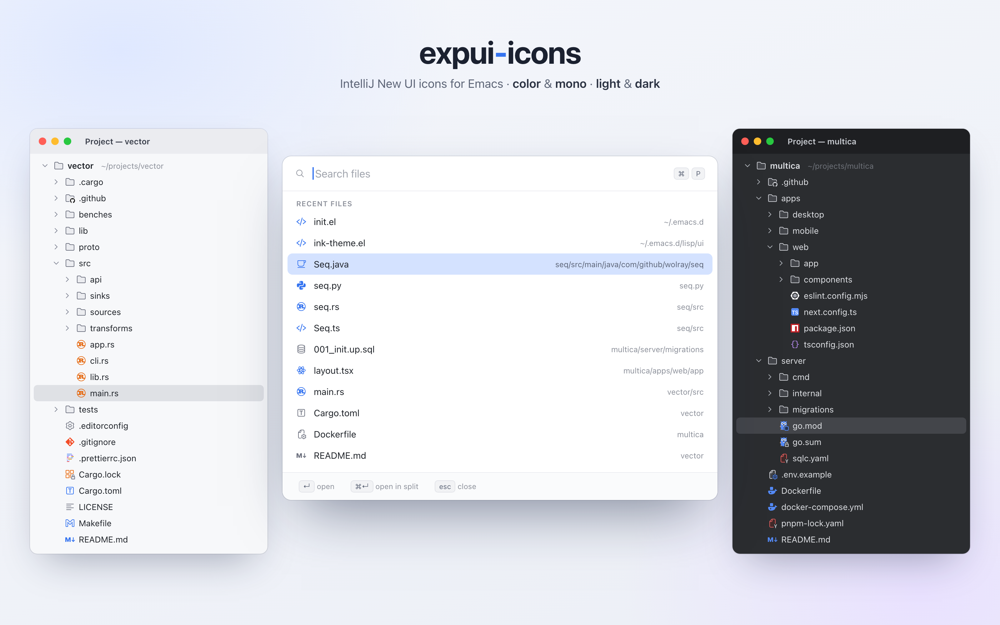

# expui-icons

English | [简体中文](README.zh-CN.md)



Icons for Emacs from IntelliJ's New UI: the whole `expui` icon set of
[intellij-community](https://github.com/JetBrains/intellij-community)'s
platform (818 icons: file types, folders, code elements, actions, tool
windows, …) plus file-type icons from JetBrains plugins (Python, Kotlin, Go,
Rust, Ruby, JavaScript, C/C++, …).  The icons are
SVGs with light and dark variants, drawn either in their original colors or in
a single color that follows the face they are shown with.  File names, major
modes and buffers map to file-type icons.

This is an independent project, not affiliated with or endorsed by JetBrains.

## Requirements

Emacs 29.1 or later built with SVG support (librsvg).  Developed and tested
on Emacs 31.1; package-lint checks the API against 29.1.  In terminals, or
without SVG support, the string functions return a text fallback instead.

## Usage

```elisp
(require 'expui-icons)

;; Strings to `insert' or `concat', like nerd-icons:
(expui-icons-icon-for-file "main.py")
(expui-icons-icon-for-dir "~/src/.github/")
(expui-icons-icon-for-buffer (current-buffer) :face 'shadow)
(expui-icons-icon-for-mode 'emacs-lisp-mode :height 20)
(expui-icons-icon-for-extension "rs")
(expui-icons-icon "general/chevronRight")
(expui-icons-icon "nodes/class" :face 'font-lock-type-face)

;; Icon names and images:
(expui-icons-name-for-file "Dockerfile")   ; => "docker"
(expui-icons-name-for-mode 'js-json-mode)  ; => "json"
(expui-icons-name-for-extension "PY")      ; => "python"
(expui-icons-name-for-buffer)              ; file, Dired directory or mode
(expui-icons-image "python" :scale 2)      ; image descriptor
(expui-icons-names)                        ; every available icon
(expui-icons-names "nodes")                ; one category
```

Icon names are paths under `icons/` without `.svg`.  File-type icons have
plain names (`python`, `anyType`); every other icon, including folders
(`nodes/folder`), keeps IntelliJ's directory, such as `nodes/method`,
`general/chevronDown`, `actions/addFile` or `toolwindows/project`.  Size
variants (`name@20x20.svg`) are not included.

The string functions accept `:face`, which in the `mono` style sets the icon's
color, and image properties such as `:height` (pixels) or `:scale`, which
override the defaults.  Icons are centered on the line (`:ascent center`).
File-type and node icons are 16×16 and shown exactly `expui-icons-height`
(16) pixels high; icons with other design sizes (14px gutter icons, 28px
dialog icons, …) are scaled by the same factor.

### nerd-icons compatibility

`expui-icons-icon-for-file`, `-icon-for-dir`, `-icon-for-extension` and
`-icon-for-mode` have the same signatures as their nerd-icons counterparts and
accept the same arguments, so code written for nerd-icons can switch by
renaming the functions:

- `:face` sets the face (and the `mono` color);
- a float `:height` is a factor of the default size, like nerd-icons' height
  relative to the font (`:height 0.8`); an integer `:height` is in pixels;
- `:v-adjust` is ignored, because the icons are always centered;
- arguments whose value is nil mean "use the default".

Differences: the icons are images, so terminals get
`expui-icons-text-fallback` instead of a glyph; `icon-for-dir` looks only at
the name and never touches the file system (no special icon for remote,
symlinked or Git directories); there is no `icon-for-url`; and
`expui-icons-icon-for-buffer` is an addition.

### Options

| Option | Meaning |
| --- | --- |
| `expui-icons-style` | `color` (as designed) or `mono` (in the face's foreground; see `expui-icons-toggle-style`) |
| `expui-icons-background` | `auto`, `light` or `dark`: which variant `color` uses.  `auto` checks the default face's background, since `background-mode` is not always right |
| `expui-icons-height` | Pixel height of a 16×16 icon, or nil to scale like other images |
| `expui-icons-text-fallback` | String, or function of the icon name, used without SVG support |
| `expui-icons-file-name-alist`, `expui-icons-directory-name-alist` | Regexps on base names (`Makefile`, `.github`, …) |
| `expui-icons-extension-alist` | Lowercase extensions |
| `expui-icons-mode-alist` | Major modes; exact matches first, then the first parent mode (`prog-mode` → `xml`, `text-mode` → `text`) |
| `expui-icons-mono-substitutes` | Solid badge icons replaced in `mono`, where they would be blocks |

Languages that JetBrains ships no icon for (Emacs Lisp, Haskell, Lua,
Clojure, …) use the generic `</>` icon (`xml`).

Images are cached by name, style, variant and properties.  Changing an option
with Customize or `setopt` clears the cache; `expui-icons-clear-cache` also
reloads edited SVG files.

## Icons

`icons/` holds the SVG files (about 6 MB), copied unmodified from
intellij-community and
[intellij-icons.jetbrains.design](https://intellij-icons.jetbrains.design);
see [`icons/README.md`](icons/README.md) for their origin and license.

To add icons, edit `scripts/manifest.txt` and run
`scripts/update-icons.sh --update-site`; the script's header explains the
details.  A weekly GitHub Actions workflow does the same against the latest
upstream and, when an icon changed and `make` passes, releases a patch
version.

## Development

```sh
make          # byte-compile (warnings are errors), checkdoc, ERT tests
scripts/hero.sh  # redraw docs/hero.png (needs Google Chrome)
```

## License

The code is licensed under the Apache License 2.0 (`LICENSE`).  The icons are
also Apache 2.0, © JetBrains s.r.o. and contributors.  Some icons from
intellij-icons.jetbrains.design (Go, Rust, …) have no license header; see
[`icons/README.md`](icons/README.md) for why they are included.  Logos of
languages and tools remain trademarks of their owners.
